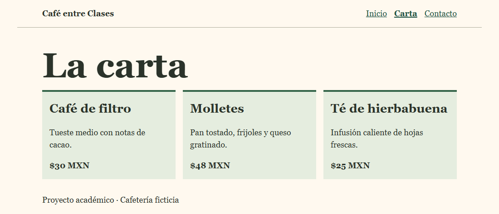
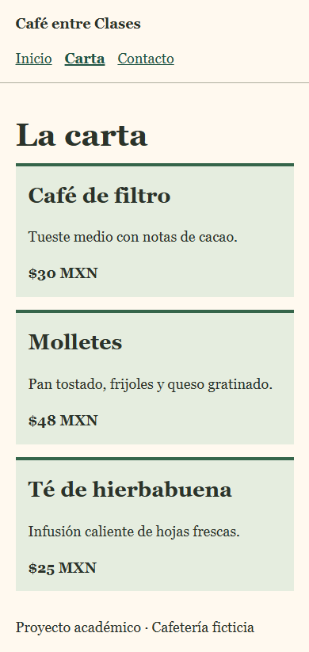

# Café entre Clases
Sitio académico de una cafetería universitaria. Permite consultar la carta y escribir al equipo. Utiliza HTML5 y una hoja CSS con Grid, Flexbox y una consulta de medios a 640 px.

## Uso y publicación
Extrae el ZIP y abre index.html. Para publicarlo, sube el contenido extraído a la raíz del repositorio. En Settings > Pages, selecciona Deploy from a branch, la rama con los archivos y la carpeta / (root). Al terminar el despliegue, abre la dirección indicada por GitHub y repite la prueba de navegación.

## Resultados locales · 9 de noviembre de 2026
En Edge se abrieron Inicio, Carta y Contacto desde cada una de las tres páginas a 1100 y 390 px. Los dos enlaces de correo tienen el destinatario indicado y el salto de teclado enfoca el contenido. Ninguna página tuvo desplazamiento horizontal. La carta mostró tres columnas en escritorio y una en móvil. W3C Nu devolvió cero mensajes en los tres HTML. El validador CSS devolvió cero errores y cero advertencias.

